# Android 验证记录

日期：2026-10-05（Asia/Shanghai）。

新增 `Android` 原生 Android Studio 工程，手机和平板使用同一个 APK。Apple 工程保留。安卓源码不使用 WebView 或网页包装，正文为原生 EditText。

## 构建结果

- Android Studio 2026.2.1 自带 JBR 25；Java 源码 / 字节码目标为 17。
- Android Gradle Plugin 9.4.1、Gradle 9.6.0、SDK Platform 37、Build Tools 36.0.0。
- `assembleDebug`、`testDebugUnitTest`、`lintDebug`、`assembleDebugAndroidTest` 成功。
- 在 Android Studio 打开工程，点击 `Run app`，IDE 显示安装成功并启动手机模拟器。
- 调试 APK 通过 `apksigner verify --verbose`，APK Signature Scheme v2 校验成功。
- 安装包：`Build/Android/jianzuo-android-debug.apk`；校验文件：`Build/Android/SHA256SUMS.txt`。
- Lint：0 个错误，2 个依赖版本更新提示（固定 Gradle / 测试用 org.json 版本）；无运行兼容性错误。

构建版本关系参考 [Android 官方 AGP 9.4 兼容性说明](https://developer.android.com/build/releases/agp-9-4-0-release-notes)。

## 自动验证

| 验证 | 结果 |
| --- | --- |
| 9 项 JVM 单元测试 | 全部通过 |
| 手机尺寸 5 项设备测试 | 全部通过；最终源码另用指定模拟器运行，再次通过 |
| 平板竖屏：1600 × 2560 px、320 dpi（800 dp 宽） | 双栏布局与中文编辑、预览、专注、重建、保存测试通过 |
| 平板横屏：2560 × 1600 px、320 dpi（1280 dp 宽） | 三栏布局与中文编辑、预览、专注、重建、保存测试通过 |

设备验证使用同一个 API 37 Android 模拟器，调整显示尺寸和密度验证手机 / 平板窗口；没有把显示尺寸验证表述为平板真机测试。

单元测试覆盖中英文与补充平面汉字统计、Unicode / 元数据存储往返、搜索 / 收藏 / 排序、废纸篓恢复 / 删除、独立副本、空库保留、无效快照拒绝、代码块空白和未闭合围栏、Markdown 段落 / 引用 / 列表。

设备测试覆盖：中文标题 / 正文编辑、Markdown 预览切换、专注模式、页面重建后正文保留、落盘内容一致、当前窗口栏位选择、返回列表和无匹配搜索提示；另验证损坏文件不覆盖、AtomicFile 写入 / 空库重载、中断写入的旧 `.bak` 恢复、UTF-8 BOM 与无效字节处理。

原始日志保存在本地 `Build/Android/validation/`（构建产物不提交到 Git）。

## 文件导入导出

在手机模拟器中通过系统 DocumentsUI 文件选择器：

1. 导出示例文稿「把日子写成诗」为 Markdown。
2. 读取导出的 UTF-8 文件，与示例正文逐字比较一致（839 字节）。
3. 将同一文件导入简作。
4. 读取应用私有文稿库，确认导入文稿与原文正文相同，且文稿编号不同。

## 界面检查

以下均为应用实际模拟器截图，使用内置示例文稿；手机尺寸与平板竖屏 / 横屏、跟随系统深色模式均完成视觉检查。

### 手机编辑

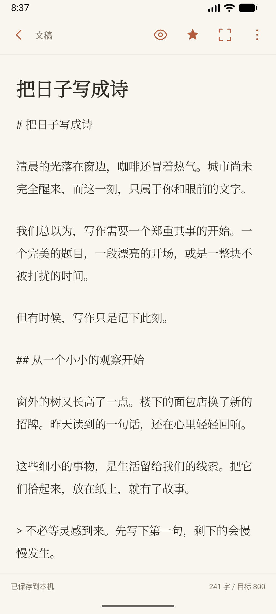

### 平板横屏三栏

### 平板竖屏双栏

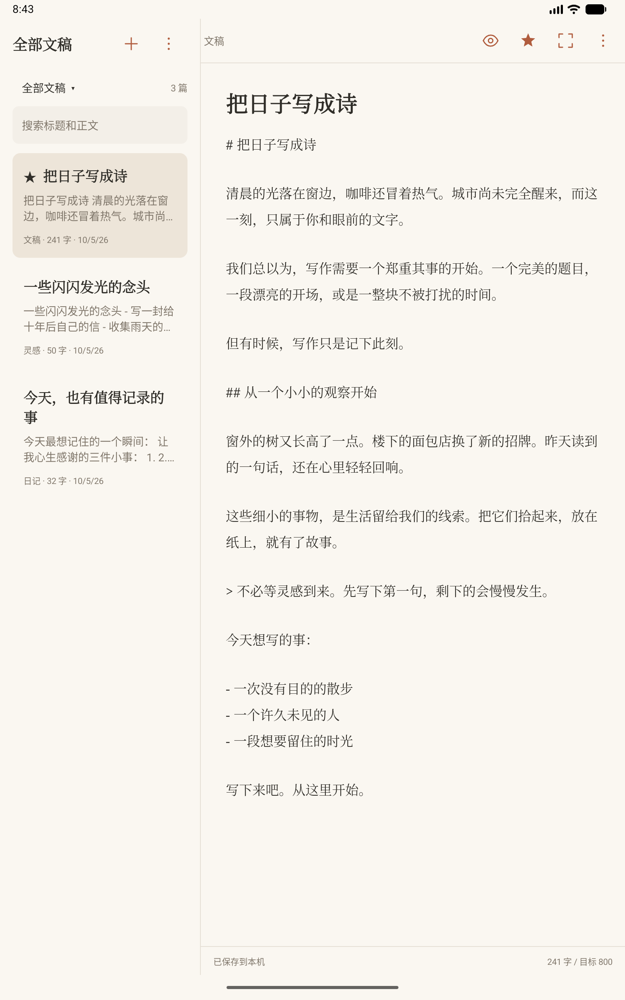

### 平板深色模式

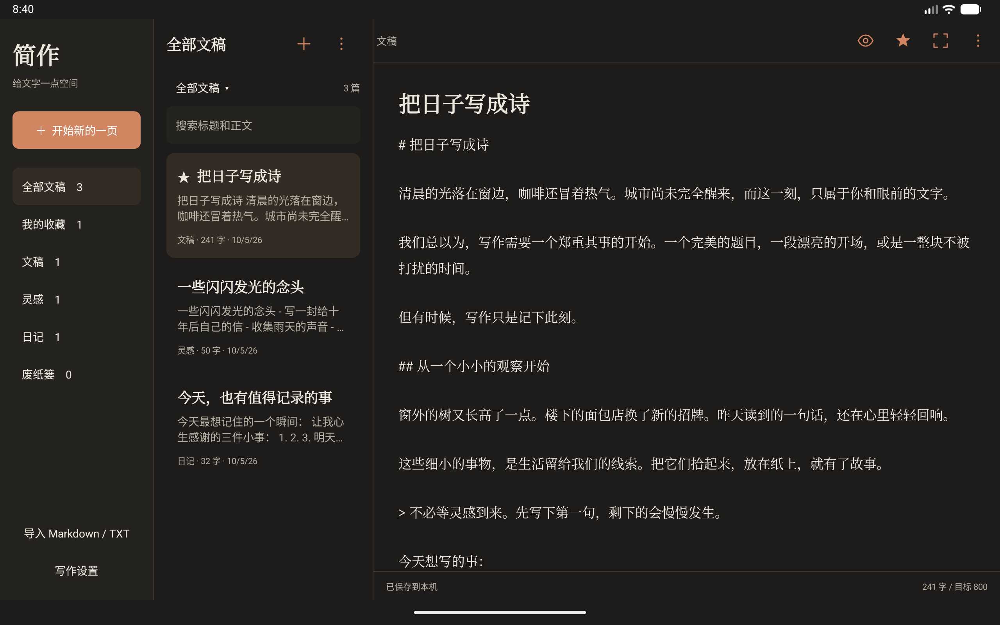

## 验证范围

已验证 API 37 模拟器上的上述行为；尚未在安卓手机或平板真机，以及 Android 8.0–16 的模拟器运行。最低 API 26 的编译与 Lint 检查通过。正式分发需要自己的发布签名；当前交付为可直接安装的调试 APK。

## 1.1.0 竞品功能借鉴扩展验证

同日追加，功能发现范围和实现差异详见 [纯纯写作 APK 检查报告](PureWriter-analysis.md)。

- `assembleDebug`、`testDebugUnitTest`、`lintDebug`、`assembleDebugAndroidTest` 通过。
- 17 项 JVM 测试全部通过；新增覆盖旧库升级、备份篡改拒绝、历史恢复／容量、自定义笔记本与元数据合并、成书顺序、Unicode 查找／字面替换、排版／大纲（含 Windows 换行）、任务与表格预览。
- 11 项设备测试在手机 1080 × 2400 / 420 dpi、平板横屏 2560 × 1600 / 320 dpi、竖屏 1600 × 2560 / 320 dpi 均通过。各尺寸使用同一个 API 37 模拟器的显示覆盖，没有声称真机验证。
- 新增设备测试覆盖通过菜单替换／恢复历史／只读、速记后台保存与重建、旧库自动快照、PDF／PNG 有效文件、ZIP Unicode 与无效路径拒绝、中文组合输入与标点补全／删除／动态缩进。
- 自动化测试期间关闭模拟器窗口／转场／属性动画，以避免 PopupMenu 的动画时序导致测试点击或根窗口定位失败。测试后恢复原设置。部分菜单测试直接触发原生按钮的点击回调；另以 ADB 实际点击核查功能菜单、历史列表和系统文件选择器。
- PDF 测试生成 57 页，使用 Android PdfRenderer 打开并渲染第一页、末页，已检查两页和 PNG 长图。常规中文／英文排版正常；模拟器缺少补充平面汉字 `𠀀` 字形，原始 Unicode 数据仍保留，视觉显示取决于字体。
- 通过系统 DocumentsUI 导出包含 3 篇演示文稿及每篇 2 个历史版本的 .jzb；读回文件校验 SHA-256 与元数据一致。
- 同样通过系统选择器导入该 .jzb，在合并预览确认后回到后台触发保存，读回库确认 3 篇原稿正文不变、额外 3 篇使用不同 ID，历史记录保留。
- APK Signature Scheme v2 验证通过；调试版 `versionName=1.1.0`、`versionCode=2`，约 1 MB。最终 SHA-256 在 `Build/Android/SHA256SUMS.txt`。
- Lint 0 错误，仅保留原有 Gradle／测试用 org.json 更新提示；没有通过全局禁用 Lint 消除问题。

本轮原始构建、测试、导出及恢复日志／文件位于本机 `Build/Android/features-*.log`、`Build/Android/feature-screenshots/`。模拟器截图使用独立演示数据；截图完成后恢复截图前的文稿库与设置。测试修改过的分辨率、密度和动画配置也恢复。

### 新功能实际截图

自定义笔记本、卷名、章节列表和快捷输入栏：

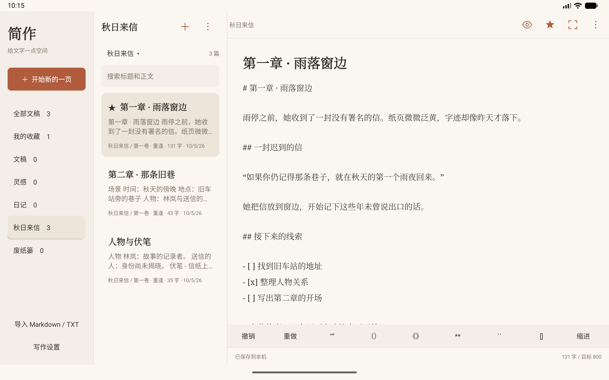

写作工具菜单与历史版本：

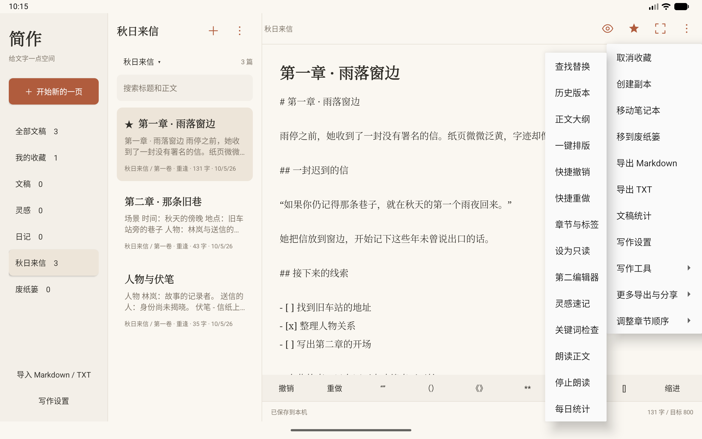

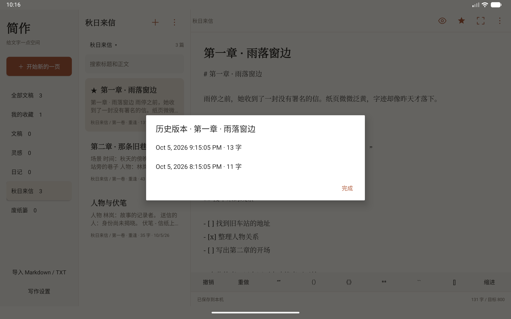

备份合并预览：

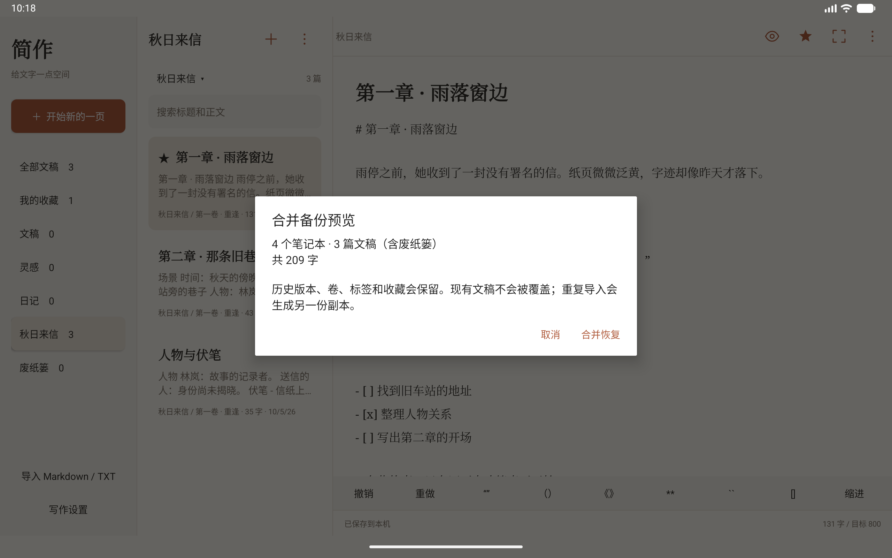

本轮尚未在有设备密码的手机完成真实解锁验证，也未验证中文 TTS 播放、自定义字体的系统文件选择流程，以及 Android 8.0–16 真机／模拟器。AI、云服务和第三方专用迁移格式没有接入；对照报告逐项列明。原有深色适配保留，本轮新增截图以浅色为主。

## 1.2.0 本地功能补齐验证

日期：2026-10-07（Asia/Shanghai），`versionName=1.2.0`、`versionCode=3`。

- `assembleDebug`、`testDebugUnitTest`、`lintDebug`、`assembleDebugAndroidTest` 通过；Lint 0 错误，仅有原有 Gradle／测试用 org.json 更新提示。
- 26 项 JVM 单元测试通过。新增 9 项覆盖差异还原与末尾换行、大篇幅差异降级、按原始位置勾选替换与零宽匹配、段落移动与光标、多字段关键词交集及相关度、闰年与连续天数、DOCX／EPUB 的 XML 包结构和 Unicode、危险 HTML 转义。
- 16 项设备测试在手机 1080 × 2400 / 420 dpi、平板横屏 2560 × 1600 / 320 dpi、平板竖屏 1600 × 2560 / 320 dpi 全部通过，仍使用同一个 API 37 模拟器的尺寸覆盖。
- 新增设备测试实际操作勾选替换与历史差异、段落移动及光标、导入预览改名／重排、笔记本快捷方式冷启动／页面重建，以及缩进删除／换行标点规则与中文组合输入。
- 通过系统 DocumentsUI 多选两篇 Markdown／TXT，确认后落盘，读回两篇完整正文与原始 UTF-8 文件逐字一致。对导入弹窗做最终视觉调整：少量文稿时缩短列表，窗口较矮时限制列表高度。
- 通过系统保存窗口导出 DOCX 和 EPUB，再拉回文件。系统 `textutil` 识别 DOCX 并正确读回中文／补充平面汉字；带标题、粗斜体、引用、代码、表格的样例 DOCX 已用 macOS Quick Look 渲染并检查。
- 样例 EPUB 与从系统保存窗口导出的 EPUB 均通过 [官方 EPUBCheck 5.4.0](https://github.com/w3c/epubcheck/releases/tag/v5.4.0)，按检查器的 EPUB 3.4 规则得到 0 fatal、0 error、0 warning。应用导出 EPUB 3 包，未引入运行时依赖。
- 在模拟器桌面实际确认固定「灵感」快捷方式，结束应用进程后点快捷方式，正确打开「灵感」列表。改名更新和删除后禁用已实现，但额外人工复核期间模拟器 ADB 连接反复中断，未把这两项算作完整实测。
- APK Signature Scheme v2 验证通过，约 1.1 MB；最终 SHA-256 见 `Build/Android/SHA256SUMS.txt`。

设备测试修正了导入对话框的 Espresso 根窗口定位。另一次并行测试发生进程冲突，已废弃该次结果；最终按尺寸串行重跑并保留各自 XML 结果。没有把工具时序失败计为功能通过。

测试完成后已恢复模拟器原始分辨率／密度、窗口／转场动画为 1，删除测试设置的属性动画覆盖。

原始日志、测试 XML、导出文件与 EPUBCheck 位于本机 `Build/Android/validation-1.2/`（不提交）。本轮最初的模拟器未安装简作，自动化只使用测试文稿；系统导入／导出的样本均为自建测试文本。未访问其他应用文档内容。

云同步、AI、第三方专用迁移格式、图片资产、常驻双编辑器等剩余功能见 [更新后的功能对照](PureWriter-analysis.md)。真实设备密码锁、中文语音播放及旧系统真机验证的限制仍适用。

## 1.3.0 分卷与章节整理验证

日期：2026-10-07（Asia/Shanghai），`versionName=1.3.0`、`versionCode=4`。

- `assembleDebug`、`testDebugUnitTest`、`lintDebug`、`assembleDebugAndroidTest` 通过。37 项 JVM 测试通过；Lint 0 错误，仅保留原有 Gradle／测试用 org.json 更新提示。
- 新增 11 项 JVM 测试覆盖旧库分卷迁移（包括较长旧卷名）、空卷与稳定 ID 备份往返、无效／重复／跨本引用拒绝、成书分卷顺序、章节跨卷排序、整卷含废纸篓移动及冲突拒绝、解散／恢复、备份合并顺序、编号历史／跳过只读、过期计划整批拒绝和精确标签解析。
- 20 项设备测试在手机 1080 × 2400 / 420 dpi、平板横屏 2560 × 1600 / 320 dpi、平板竖屏 1600 × 2560 / 320 dpi 全部通过。仍使用同一个 API 37 模拟器的显示覆盖。
- 新增 4 项设备测试实际操作空卷目录、折叠与页面重建、长按卷标题改名、编号预览／确认与历史保留、精确标签筛选及重建，以及原生长按触摸拖动章节到空卷。拖动后读回磁盘，确认分卷关联改变、正文和其他章节不变。
- 原始 Gradle 设备运行遇到本机 ADB 守护进程异常中断，该次不计通过。最终串行使用 AndroidJUnitRunner 直接运行；本机连接不稳定时在设备侧保留结果，并结合 TestRunner 完成日志核查。修正了测试中的下拉弹窗根窗口定位和后台生命周期等待方式。
- 分卷目录与编号使用应用自有 Java／Android View 实现，不引入竞品代码、图标或素材；没有新增网络或存储权限。
- 库格式 3 可读取格式 1／2，旧卷名按手动章节顺序首次出现的位置迁移；历史与正文保留。格式 3 需用简作 1.3.0 或更新版读取，旧版本不支持向下兼容。
- APK Signature Scheme v2 验证通过，约 1.1 MB；最终 SHA-256 见 `Build/Android/SHA256SUMS.txt`。

原始构建、签名、设备测试结果和演示数据位于本机 `Build/Android/validation-1.3/`（不提交）。尚未验证旧 Android 系统与真机；设备密码锁／中文 TTS 等前述限制保持不变。拖动当前可见的目标，尚无拖动自动滚屏；目录不支持任意深度嵌套。

本轮设备测试前备份原文稿库、自动快照和界面设置，截图使用独立的「秋日来信」演示数据。结束后已恢复备份中全部 3 个原文件，并逐字节比较一致；模拟器恢复 1080 × 2400 / 420 dpi，窗口／转场动画恢复为 1，删除属性动画覆盖。

分卷目录实际截图（第一卷已折叠，第三卷为空卷）：

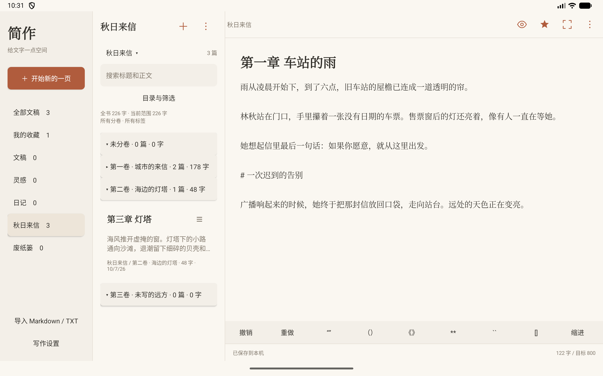

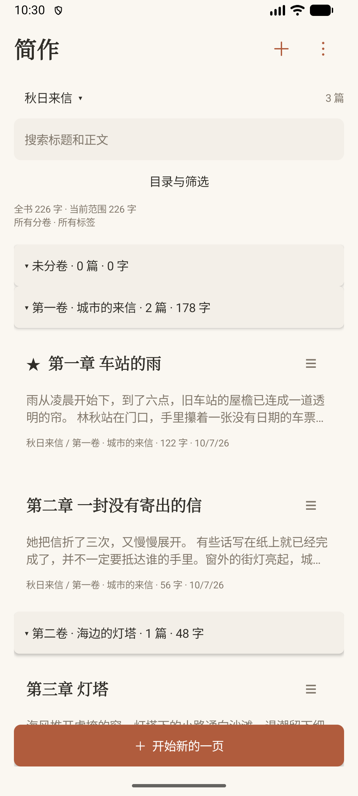

## 1.4.0 双稿与长篇整理验证

日期：2026-10-07（Asia/Shanghai），`versionName=1.4.0`、`versionCode=5`。

- 构建、39 项 JVM 单元测试及 Lint 通过；Lint 0 错误，仅保留原有 Gradle／测试用 org.json 更新提示。新增单元测试验证章节前后创建的位置、分卷／标签继承、只读原章不变、备份往返，以及无效插入请求不改变库。
- 26 项设备测试分别在手机 1080 × 2400 / 420 dpi、平板横屏 2560 × 1600 / 320 dpi、平板竖屏 1600 × 2560 / 320 dpi 全部通过。三种显示配置仍来自同一个 API 37 模拟器。
- 新增设备测试验证双稿分别编辑／保存、历史与每日新增量、光标与选区恢复、页面重建与正常关闭后重开、独立预览／只读保护／选稿排重、比例与横竖布局、相对进度联动和独立滚动恢复。
- 测试发现参考稿的「当前篇」替换仍引用主稿 ID，已修正。另以跨笔记本的参考稿验证勾选替换和「当前笔记本」批量替换范围，确保工具使用当前激活稿。
- 通过实际菜单在章节前创建新章，读回磁盘验证顺序、正文及标签／分卷。原生触摸测试长按拖到目录底部并保持，自动滚屏至原先隐藏的空卷后松手，验证归属改变而正文保留。
- 本机 ADB 守护进程仍偶发中断，测试结果在设备端保存后拉回。修正了章节菜单及历史差异对话框测试的根窗口定位；失败的中间结果单独保留，未计为通过。
- 完成全部设备测试后，仅调整双稿标题按钮的透明背景与左对齐，再次构建、运行全部 JVM 测试和 Lint、验证签名，并检查手机／平板实际截图。截图文件与设备端 SHA-256 一致，避免连接中断造成不完整图片。
- APK Signature Scheme v2 验证通过，约 1.1 MB；最终 SHA-256 见 `Build/Android/SHA256SUMS.txt`。文稿库格式仍为 3，整库 .jzb 与 1.3.0 兼容。

本轮原始构建、设备结果、签名及恢复核验保存在本机 `Build/Android/validation-1.4/`（不提交）。双稿联动按滚动范围比例对应，不进行段落语义匹配；双稿选择与阅读位置属于本机界面设置，不进入 .jzb。仍未验证旧 Android 系统和真机，设备密码锁／中文 TTS 等前述验证限制保持不变。

测试及截图前备份原文稿库、自动快照和界面设置，截图使用独立的「秋日来信」演示数据。结束后恢复全部 3 个原文件并逐字节比较一致；恢复 1080 × 2400 / 420 dpi、窗口／转场动画为 1，并删除属性动画覆盖。

实际双稿界面：平板主稿占 60%，参考稿独立预览；手机自动改为上下排列。

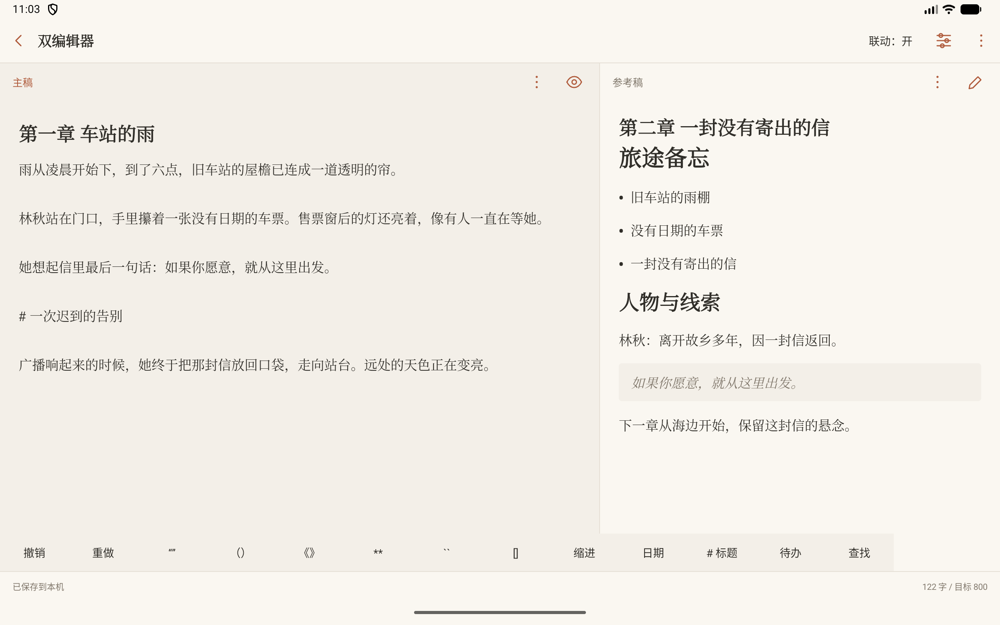

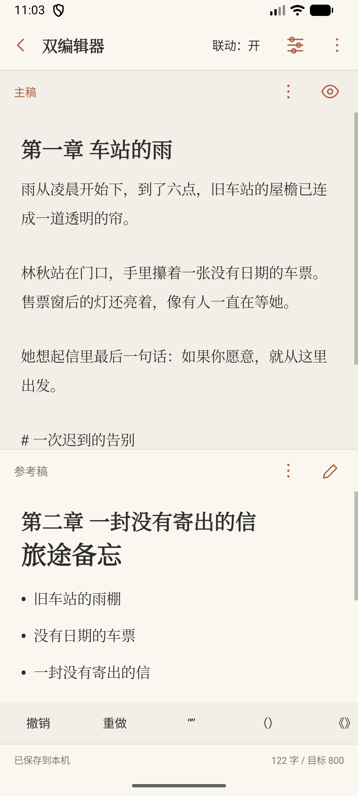

## 1.5.0 快捷栏与选区统计验证

日期：2026-10-08（Asia/Shanghai），`versionName=1.5.0`、`versionCode=6`。

- 构建、45 项 JVM 单元测试及 Lint 通过；Lint 0 错误，仅保留原有 Gradle／测试用 org.json 更新提示。新增 6 项单元测试覆盖旧快捷项迁移、直接换行／竖线／美元符号／反斜线、同名项的独立身份、隐藏和排序往返、空栏与少量项目、无效配置拒绝及 Unicode 计数。
- 全部 29 项设备测试分别在手机 1080 × 2400 / 420 dpi、平板横屏 2560 × 1600 / 320 dpi、平板竖屏 1600 × 2560 / 320 dpi 通过。三种配置仍使用同一个 API 37 模拟器，最终结果为 `final-*-tests.txt`。
- 新增设备测试实际操作配置取消／保存、旧快捷项多行内容编辑、首位排序、三行布局、按光标插入、重建后保留、恢复默认布局但保留自定义内容；另以真实触摸长按拖动排序并验证隐藏状态及正文不变。
- 统计测试验证口径切换、补充汉字／表情／Unicode 空白、正向与反向选区、重建与正常关闭重开，以及双稿当前激活正文。修正了单稿启动／重新选稿只读取选区起点，以及重建时把反向选区压成光标的问题；两侧分别保留选区两端。
- 移动光标复用已有全文计数，只重新统计选中片段，避免每次光标变化重新扫描全文。
- 完整回归后补齐状态栏无障碍说明，让读屏同时读出当前数值与切换提示，并修正反向选区使用快捷项时的包裹／替换边界。最终 APK 再于三种配置专项运行统计／选区／重开／双稿及反向快捷输入测试，并验证无障碍节点含实时计数；对应 `accessibility-*-tests.txt`。最后仅统一多行快捷栏的整行背景，再次构建、运行全部 JVM 测试与 Lint、验证签名，并核对截图所安装 APK 的 SHA-256 与交付 APK 一致；最终视觉调整前的功能测试 APK 校验值另存为 `functional-apk-sha256.txt`。
- 初始模拟器休眠导致页面未取得焦点，唤醒后重新运行；行数选择测试补充原生下拉窗口定位。失败及中间结果单独保存，未计入通过结果。
- APK Signature Scheme v2 验证通过，约 1.2 MB；最终 SHA-256 见 `Build/Android/SHA256SUMS.txt`。未新增运行时依赖或权限，文稿库仍为格式 3，整库备份兼容 1.3／1.4。

快捷栏、统计口径保存在本机界面设置，不进入 .jzb；文稿目标、目录和每日统计继续使用混合字数。字符按 Unicode 码点计数，不等同于视觉字形数量。选区计数用于可编辑正文，Markdown 预览和只读阅读区仍显示全文计数。旧快捷项插入内容保留，过长的旧名称缩短为 24 个字符；原始旧设置仍保存在本机偏好中。

原始构建、签名、设备结果、截图校验及恢复核验位于本机 `Build/Android/validation-1.5/`（不提交）。测试前备份原文稿库、自动快照和界面设置；截图使用独立「秋日来信」演示数据。结束后恢复全部 3 个原文件并逐字节比较一致，恢复原始 1080 × 2400 / 420 dpi、窗口／转场动画为 1，删除属性动画覆盖。仍未验证旧 Android 系统与真机，设备密码锁／中文 TTS 等前述限制保持不变。

手机三行快捷栏及字符口径：

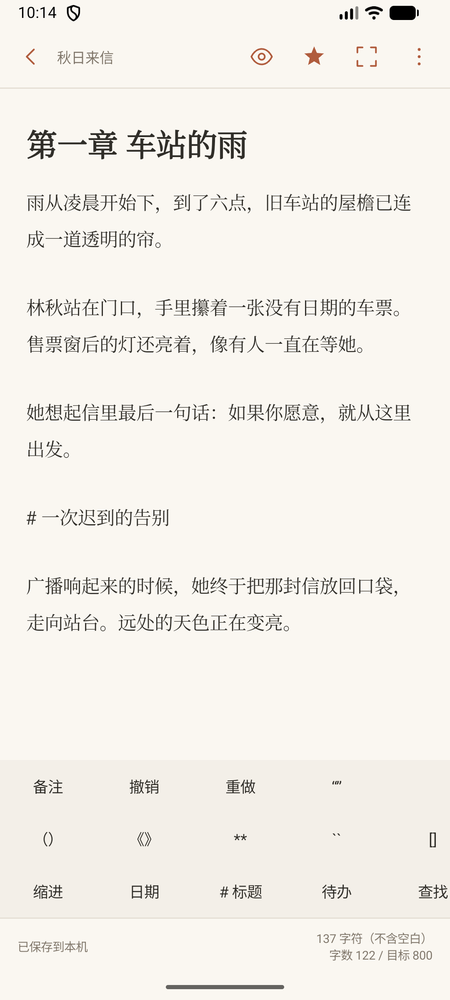

快捷栏项目管理：

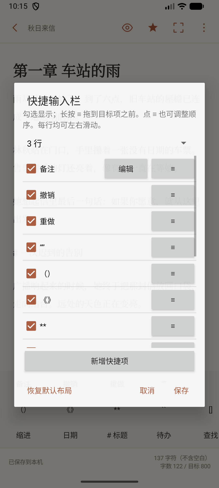

平板深色双稿与三行快捷栏：

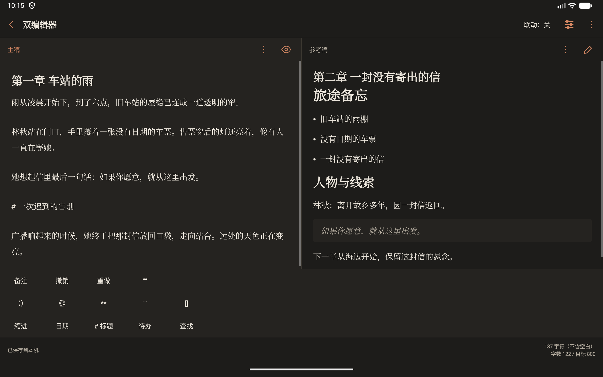

## 1.7.0 未完成功能检查与导入补齐

日期：2026-10-08（Asia/Shanghai），`versionName=1.7.0`、`versionCode=8`，库格式仍为 4。检查结果和剩余产品范围见 [未完成功能检查记录](Android-unfinished-audit.md)。

- 最终调试构建、全部 **65 项 JVM 单元测试**及 Lint 通过。Lint 为 0 错误、2 个现有依赖版本提示（Gradle 分发版本和测试用 org.json），没有新增运行时依赖或存储／网络权限。
- 最终 APK 的全部 **39 项设备测试**分别在手机 **1080 × 2400 / 420 dpi**、平板横屏 **2560 × 1600 / 320 dpi**通过，均为 API 37 的同一个 AVD；没有跳过测试。最终结果保存在本机 `Build/Android/validation-1.7/verified-full-phone-results/` 和 `verified-full-tablet-results/`，对应构建日志为 `verified-full-*.txt`。
- 新增 5 项 JVM 测试覆盖递归文件夹的稳定顺序、第一层笔记本归属、更深层合并、BOM／中文／补充汉字／表情、隐藏与非文本附件跳过、损坏编码、失效文件、循环引用、空目录、5,000 条目／1,000 篇／2 MB／64 MB 限制，以及保留字和 Unicode 笔记本名称边界。
- 新增 6 项设备测试实际经过系统 DocumentsProvider 创建和读取嵌套目录、文件夹返回后立即重建、系统打开 Markdown、多文件 URI 去重、分享文字预览／取消／确认、旋转保留已保存的标题及勾选、确认后不重复导入，以及分享时复用已有页面。
- 大导出测试以数 MB Unicode 正文核对临时快照往返、Bundle 小于 64 KB、重建保留 ID、取消清理和无效 ID 拒绝；另在重建后接收系统文件 URI，替换原有文件内容，读取最终导出文件并逐字比较，确保中文、补充汉字、表情和换行完整。
- 目录扫描使用独立线程队列，避免长时间读取阻塞文稿写入。扫描状态和导入预览候选通过配置保留对象跨旋转交接；进程终止后仍需重新选择来源。预览详情未点击「保存」的修改不恢复。
- 专项测试发现小屏导入预览按单篇 64 dp 估算时长标题会裁切，已提高最小高度并限制列表标题行数，详情保留完整文字；最终手机勾选／旋转测试通过。另修复导入后残留标签／分卷筛选隐藏新文稿，以及大导出正文直接进入系统恢复 Bundle 的问题。
- 主机 SDK 37 ADB 服务出现 `libunwind` 崩溃；改用下载到验证目录的独立 Platform Tools 35.0.2 服务后完成测试，未替换本机 SDK。新增的 onNewIntent 测试遇到 ActivityScenario 按原始 Intent 过滤清理生命周期事件，测试仅在清理时还原启动 Intent；生产代码继续保留真实分享 Intent。初次失败和中间结果未计入最终通过结果。
- 模拟器以 `-read-only -no-snapshot` 启动，所有测试、临时目录、界面设置和截图演示数据在临时磁盘中执行，未写回原 AVD。真实系统目录夹具在测试结束后删除。截图使用清空后的测试实例与自带示例，无个人文稿。
- APK Signature Scheme v2 验证通过，大小约 1.2 MB。交付路径为 `Build/Android/jianzuo-android-debug.apk`，SHA-256：`2a6924480f0f2b8d6b1752400201f1cd7a69eae6d4e7df724359523593c3b926`，与 `Build/Android/SHA256SUMS.txt` 一致。

本轮仍未验证真实手机／平板、旧 Android 系统、真实设备密码认证与中文语音播放；云盘目录提供方的长期阻塞和扫描取消仍属已记录边界。没有发布 GitHub Release。

最终 APK 的手机界面截图已目视核对，文件夹说明与分享预览均无控件裁切；安装包哈希与交付包一致，核对记录为 `screenshot-apk-check.json`。

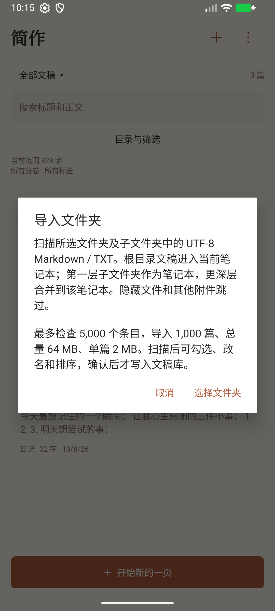

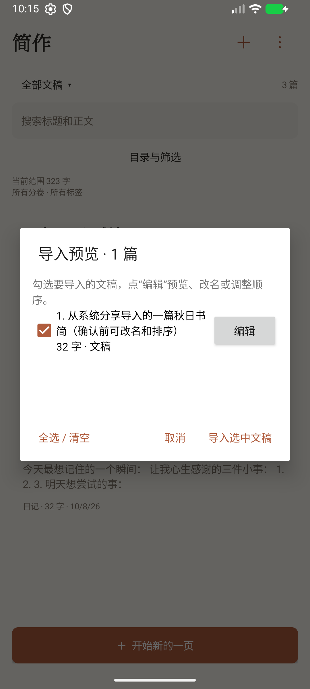

## 1.8.0 扫描控制与跨来源找回

日期：2026-10-08（Asia/Shanghai），`versionName=1.8.0`、`versionCode=9`，库格式保持 4。

- 最终调试构建、**74 项 JVM 测试**及 Lint 通过；0 错误，只有原有 Gradle／测试用 org.json 的 2 个版本提示。没有增加运行时依赖或权限。
- 最终 APK 的全部 **42 项设备测试**分别在 API 37 手机 **1080 × 2400 / 420 dpi** 和平板深色横屏 **2560 × 1600 / 320 dpi** 通过，均无失败或跳过。日志和 XML 分别位于本机 `Build/Android/validation-1.8/full-phone*`、`full-tablet*`；JVM／Lint 记录在同目录 `unit-results`、`lint-results.xml`、`build-unit-lint.txt`。
- 新增 3 项目录单测：数字自然排序（补零、超出 long 的数字）、列举前／读取中取消且关闭流、进度条目／文稿／字节计数。原有目录真实 DocumentsProvider 测试继续通过，调用已改为支持 CancellationSignal 的查询及文件读取。
- 新增 6 项找回单测：当前／废纸篓／历史／旧快照联合搜索、相同版本去重与独立文稿保留、字面及大小写匹配、不可变输入与 Unicode 片段、损坏快照跳过／读取上限／24 份范围、200 个结果上限／线程中断，以及恢复副本保持来源原文、只读和删除状态。单项测试包含多个相关断言。
- 新增 3 项设备测试：历史版本在实际找回 UI 中另存为新稿、旋转／磁盘重读后内容完整且旧正文和历史不变；只在自动快照中的内容能预览，取消后库与快照不变；进度跨重建保留，取消后迟到的候选不会弹出或导入。
- 首次找回设备测试在对话框取得焦点前由 Espresso 选到了底层 Activity 窗口；为初次输入明确使用 `isDialog()` 根匹配后通过。首次失败不计入最终回归结果。新进度文本和结果摘要使用资源格式化，最终没有新增 Lint 提示。
- 找回搜索在独立线程执行，单快照 64 MB、总读取预算 256 MB、最多 200 个版本；读取失败按保守预算计入，超限／损坏会跳过并提示。恢复仅复制标题、正文和笔记本。旋转、退出、应用锁定会关闭搜索，之后需重新输入关键词。
- 扫描线程池和取消线程池各最多两路，任务只持有应用 ContentResolver，跨旋转不持有旧 Activity。取消立即丢弃候选、打断线程并在后台关闭流／发送系统取消信号。云盘提供方忽略取消时底层等待可能继续，实际长期阻塞尚未在云盘服务上验证。
- 延续只读、无快照启动的临时 AVD 和独立 Platform Tools 35.0.2 服务；未写回原 AVD，也未替换本机 SDK。设备测试通过后，独立演示数据用于截图；未使用个人文稿。模拟器缺少部分补充汉字字形，Unicode 存储与恢复逐字比较通过。
- 最终 APK 大小 **1,068,189 字节**，APK Signature Scheme v2 验证通过。SHA-256：`f2af3301df7abafbf3a74e7c8b022d45cff08727b6a550baf92b655ffb812c3b`，与 `Build/Android/SHA256SUMS.txt` 一致；交付路径仍为 `Build/Android/jianzuo-android-debug.apk`。

仍未验证真实设备、旧 Android、设备密码认证及中文 TTS；云同步、AI、富媒体排版、整库覆盖／智能合并等范围见 [未完成功能检查记录](Android-unfinished-audit.md)。未发布 GitHub Release。

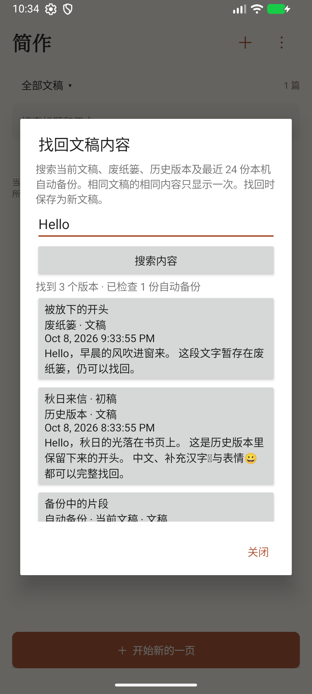

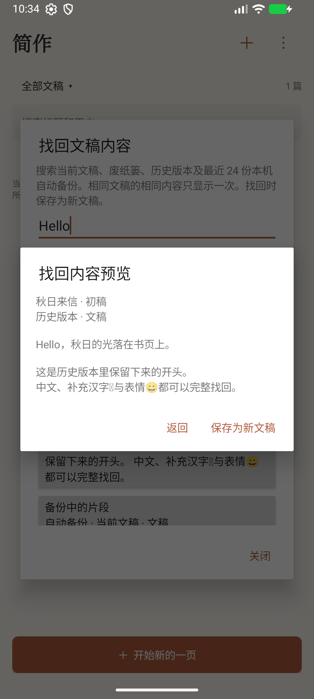

手机浅色、平板深色横屏的搜索与预览均已目视检查，按钮完整显示，结果可滚动。截图所用安装包与交付 APK 的 SHA-256 一致，记录在 `Build/Android/validation-1.8/screenshot-apk-check.json`。

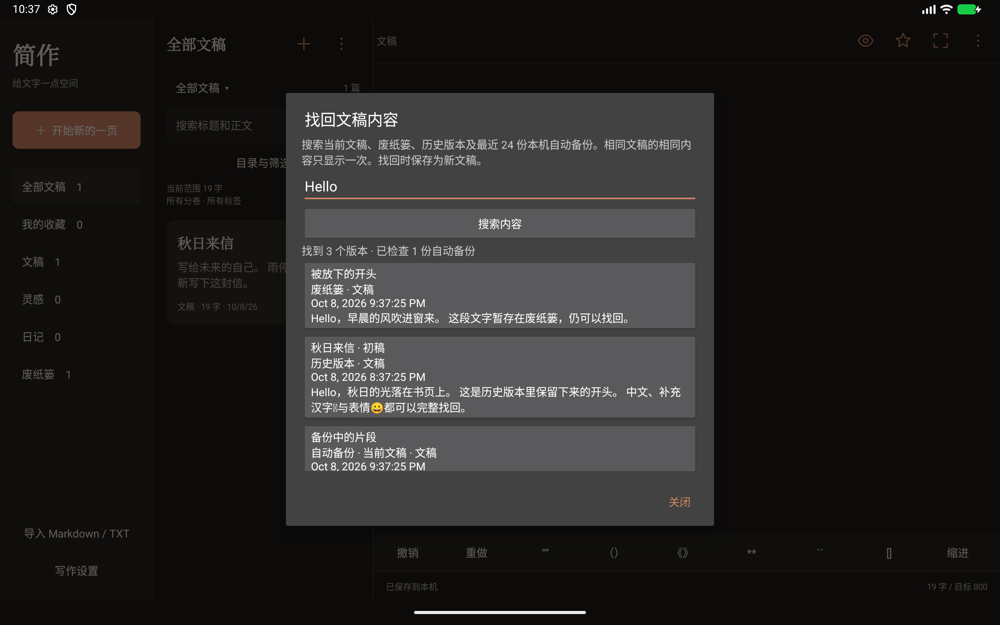

## 1.9.0 PDF／长图排版与导出保护

日期：2026-10-08（Asia/Shanghai），`versionName=1.9.0`、`versionCode=10`，库格式保持 4。

- 最终调试构建、全部 **74 项 JVM 测试**及 Lint 通过。Lint 为 0 错误、2 个原有依赖版本提示；未新增运行时依赖或权限。设置页改为读取构建版本，消除旧版号残留。
- 最终 APK 的全部 **49 项设备测试**分别在 API 37 手机 **1080 × 2400 / 420 dpi** 和平板深色横屏 **2560 × 1600 / 320 dpi** 通过，无失败或跳过。同一 AVD 的两种配置独立运行，结果为 `full-phone-results/`、`full-tablet-results/`；版号显示修复前的首轮手机结果另存为 `pre-version-phone-results/`，未代替最终包回归。
- 截图切换尺寸后发现方向锁保留，改用 `wm user-rotation lock` 并读取实际配置。一次补充回归在方向更新尚未生效时启动，首项点击因可见区域不足而失败，已中断并单独保存为 `interrupted-orientation-phone*`；最终手机回归在确认 411 × 914 dp、ROTATION_0 后重新完整运行。手机／平板实际配置分别存为 `phone-configuration.txt`、`tablet-configuration.txt`，中间结果未计入通过结果。
- 随后的 Gradle 补充运行在第 22 项收到 status -1；同一时刻独立 ADB 前台服务记录连接后来出现的 USB 设备时发生 `LIBUSB_ERROR_ACCESS` 并退出，系统日志随后记录 `deletePackageX`，测试包被卸载，未发现应用异常堆栈。这一中断单独保存在 `interrupted-uninstall-phone*`。最终手机改用指定模拟器的 `adb -s emulator-5554 shell am instrument -w -r` 直接运行，原始逐项状态为 `full-phone.txt`，49 个唯一测试的成功事件解析为 `full-phone-results/test-events.json`；平板保留 Gradle JUnit XML。没有在后来连接的其他设备上安装或测试。
- 最终 APK 大小 **1,261,260 字节**，APK Signature Scheme v2 验证通过。SHA-256：`eb9cd55a4b42846cbfd1388306e04ca870e84cd4c7bdc9c14a59f3c89796410d`，与 `Build/Android/SHA256SUMS.txt` 一致；可安装调试包仍为 `Build/Android/jianzuo-android-debug.apk`。没有发布 GitHub Release。
- 新增 **7 项设备测试**覆盖行内样式与 Unicode、原文模式、分页行覆盖和表头重复、实际 PDF／PNG 渲染、16,000 px／1,000 页上限、布局选择与取消、快照模式跨重建保留、实际系统文档的两种模式写入，以及超限时已有文件不变。最初的选择器测试在对话框取得焦点前匹配到 Activity，明确 `isDialog()` 后通过；失败未计入最终通过结果。
- 分页测试逐片核对原始文字行连续、无遗漏／重复、内容位于 720 pt 正文区内，普通标题不孤立在页尾。表格列数最多 8；更宽表格保留为原文代码块。表头超过正文区三分之一时不重复；长行按文字行续页，短单元格不在后续页重复。
- 设备生成的 9 页 PDF 包含 100 行表格及 150 行代码，文本核对完整并保留结尾标记；另一份 3 页 PDF 的超长单元格包含 400 个有序唯一标记，全部恰好一次，短单元格及尾部标记也恰好一次。使用 Poppler 渲染并目视检查页面、代码底色、表格边界及页脚；原文模式的标记保持可见。文本核对使用 NFKC 与空白归一化，以兼容系统 PDF 字体映射和提取换行，未据此宣称视觉导出可逐码点还原正文。
- 导出先完成私有临时文件，再打开系统所选目标；实际 DocumentsProvider 中预先写入标记内容，超高长图导出失败后逐字节保持一致，缓存清理通过。此保护针对排版失败；最终目标写入中的提供方故障仍可能留下不完整文件。
- 延续 API 37 只读、无快照启动的临时 AVD，初始使用独立 Platform Tools 35.0.2 服务，最后直接测试仍使用该版本客户端；没有替换本机 SDK。未写回原 AVD，结束后关闭本轮模拟器；界面使用自带示例，排版使用测试演示文字。未验证真机及旧 Android。图片、公式、原始 HTML、复杂嵌套与自定义纸张／水印仍未渲染或提供，罕见字和表情依赖设备字体。

原始构建、签名、JUnit XML、Lint、文本核对和截图安装包校验位于本机 `Build/Android/validation-1.9/`。排版示例为 [原生导出的 PDF](../output/pdf/android-1.9-markdown-example.pdf)，与下面的首页渲染、长图来自同一演示内容。

手机浅色与平板深色的排版选择和设置页均已目视检查，说明、选项、操作按钮完整，设置页显示 1.9.0；安装包哈希与交付 APK 一致，见 `screenshot-apk-check.json`。

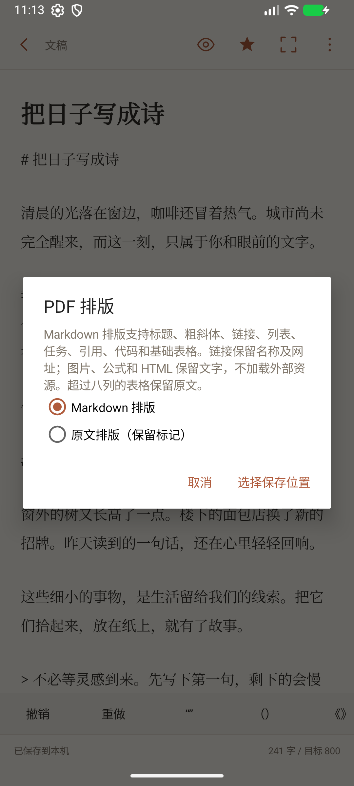

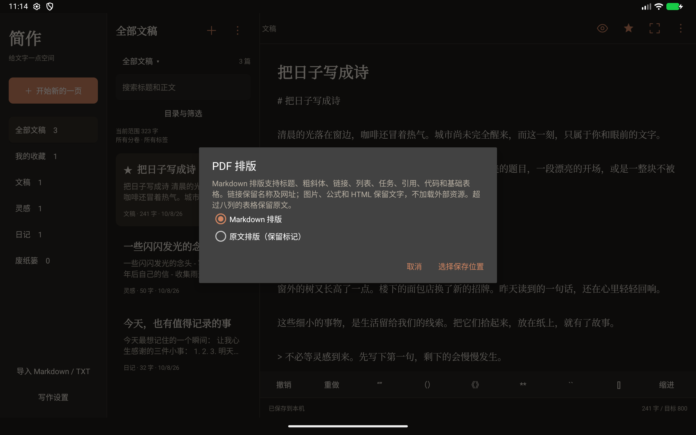

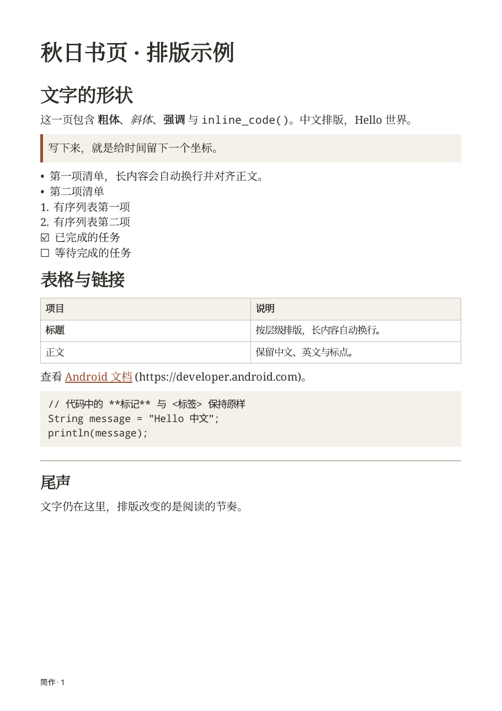

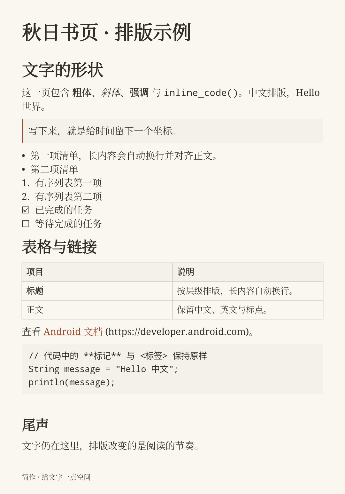

## 1.10.0 内置配色与横线稿纸

日期：2026-10-09（Asia/Shanghai），`versionName=1.10.0`、`versionCode=11`，文稿库格式保持 4。

- 最终调试构建、全部 **77 项 JVM 测试**及 Lint 通过；0 错误、2 个原有依赖版本提示，未增加运行时依赖或权限。新增 3 项单测覆盖五套主题的稳定 ID、未知／缺失主题回退、原配色兼容、十套深浅色配色的不透明度及文字对比度；强调色按钮和统计热力图的五档底色选择黑／白文字，相关组合对比度均至少 4.5。对比度检查针对这些颜色组合，不代表全应用无障碍认证。
- 最终 APK 的全部 **56 项设备测试**分别在 API 37 手机 **1080 × 2400 / 420 dpi** 和平板深色横屏 **2560 × 1600 / 320 dpi** 通过，无失败或跳过。使用指定模拟器的 `am instrument -w -r` 运行；逐项原始结果为 `full-phone.txt`、`full-tablet.txt`，解析核对 56 个唯一成功事件、连续序号及总数，保存为对应 `*-events.json`。手机最终回归全过程的 **80 次方向检查**均保持锁值 0 和 411 × 914 dp。
- 新增 **7 项设备测试**覆盖预览即时切换及取消、保存后重建／正常重开、编辑选区、完整文稿库不变、双稿与只读、Markdown 预览切换、全部十套原生控件强调色／窗口背景，以及实际横线绘制。完整库快照比较同时检查正文、历史、统计等数据没有因外观切换而变化。
- 位图检查覆盖自动换行、不同文字行距、关闭横线、空白输入区和 10,001 行文本布局的小画布绘制。另在真实 Activity 的硬件加速编辑器中加载 3,000 行正文，实际滚动至 0／1,200／8,000 px 再返回顶部，逐次读取系统截图，核对可见横线及正文不变。硬件记录画布可能覆盖整个文本视图；实现另外裁剪到视图可见区域，并在祖先滚动时使显示列表失效，离开视图后移除监听。
- 设置内的配色、明暗与稿纸选择先更新样例，点「完成」才提交；未保存的设置窗口不会跨旋转保留。保存后原生光标／控件强调色及窗口底色同步到配色。截图复核发现深色浅蓝按钮仍沿用白字，已改为根据背景亮度选择黑／白字，并对统计热力图使用相同处理；十套主题的实际主按钮文字检查通过。主题和稿纸仅保存在本机偏好，不进入 .jzb，不修改导出样式；Markdown 预览不加横线。
- 初次空白编辑器位图测试因夹具保留了 EditText 默认垂直重力而失败，夹具改为与实际编辑器一致的顶部对齐后通过。初次结果保存为 `initial-paper-fixture.txt`；原生控件主题补齐前的手机回归保留为 `pre-native-theme-full-phone.txt`，按钮对比度修复前的两次完整回归为 `pre-button-contrast-full-*.txt`，均未代替最终安装包回归。
- 末轮手机测试打开文稿时曾有一次 `scrollTo` 目标未显示，其余 55 项通过；日志保留为 `initial-list-scroll-full-phone.txt`。随后截图预检发现锁值已回到 1，窗口旋转历史记录首项启动时由 0 转为 90 度，因此这一轮不计为有效手机竖屏验证。原外观夹具只以窗口焦点及节点存在判断就绪，已增加节点实际显示／具有可见矩形的检查，并在点击前等待目标文稿行。
- 本机 Android 37 SDK 的 `UiAutomationConnection.disconnect()` 会恢复连接时保存的方向锁，推测之前平板自动化连接的清理恢复与状态回退有关；没有将此推测作为应用故障结论。最终重新设置锁值，在应用打开后连续四次确认锁值 0 与实际 411 × 914 dp，再运行完整手机回归；过程中每两秒核对锁值与实际全局配置。记录为 `phone-stable-rotation.json`、`full-phone-rotation-checks.json`，原始窗口历史及 SDK 源码片段也保留在验证目录。
- 延续 API 37 只读、无快照启动的临时 AVD，ADB 使用已有的独立 Platform Tools 35.0.2 客户端。测试与截图仅在指定的 `emulator-5554` 执行；界面使用自带示例，未使用个人文稿，未写回原 AVD。没有发布 GitHub Release。

- 最终 APK 大小 **1,272,556 字节**，APK Signature Scheme v2 验证通过；SHA-256：`1be502cb562f4acfa7e779c9b18272fd1e184cd0658f3d69053c5a9640f8a05e`，与 `Build/Android/SHA256SUMS.txt`、两种截图配置安装包及 `final-apk.json` 一致。交付路径仍为 `Build/Android/jianzuo-android-debug.apk`。原始构建、JVM XML、Lint、设备事件、签名与方向检查位于本机 `Build/Android/validation-1.10/`。

自定义颜色、背景图片、稿纸独立间距及主题文件导入／导出尚未提供。未验证真实设备、旧 Android、实际设备密码认证及中文语音播放；其余边界见 [未完成功能检查记录](Android-unfinished-audit.md)。

手机浅色「山林」和横线预览、平板深色「海雾」单稿／双稿已目视检查，预览样例、说明和操作按钮完整可见。两种配置的截图安装包 SHA-256 均与交付 APK 一致，记录为 `phone-screenshot-apk-check.json` 和 `tablet-screenshot-apk-check.json`。

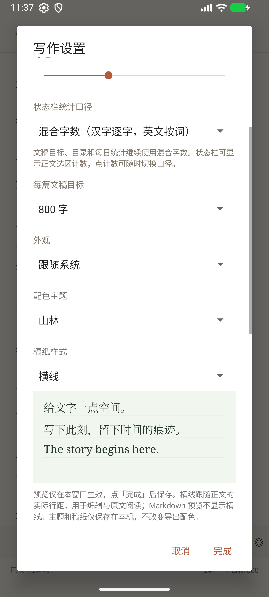

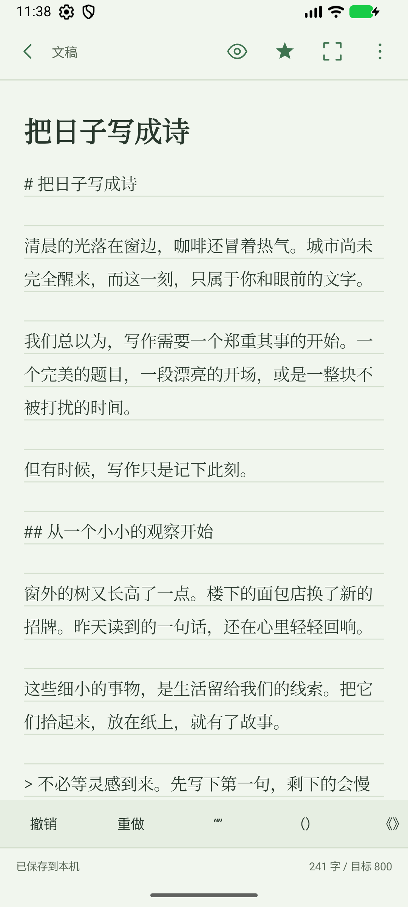

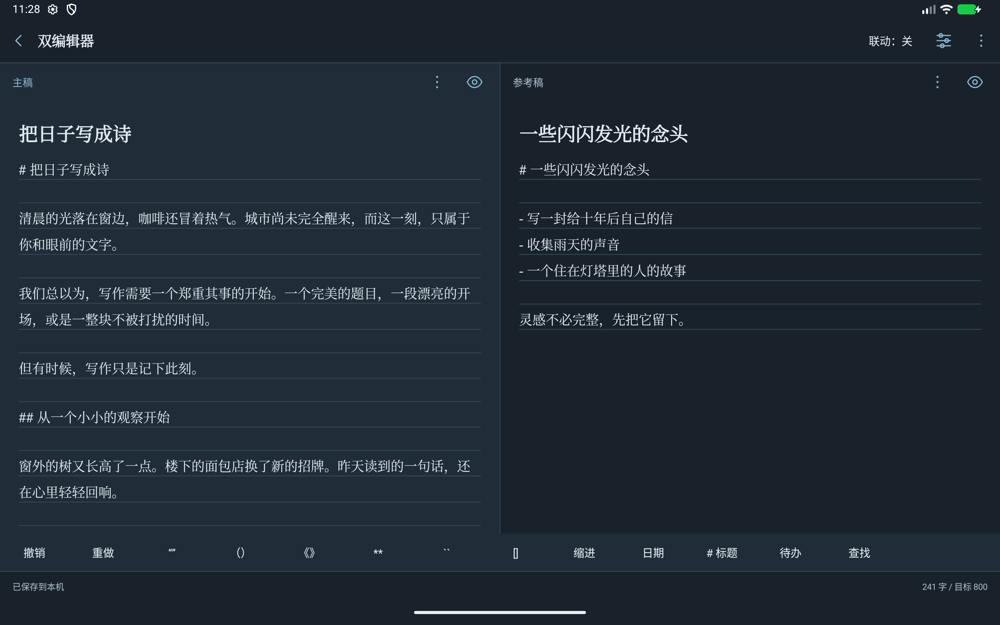

## 1.11.0 安卓中英文界面与语言切换

日期：2026-10-11（Asia/Shanghai），`versionName=1.11.0`、`versionCode=12`，文稿库格式保持 4，最低版本保持 Android 8.0。

- 提取并配对 **635 个字符串、5 组选择项数组**：默认资源为 English，简体中文位于 `values-zh-rCN`。JVM 检查两种资源的名称、数组条目数量和格式参数一致，英文资源不残留中文界面文字；语言选择中的「简体中文」采用自身语言名称。
- 「写作设置 → 界面语言」提供跟随系统、简体中文和 English，完成时提交、取消不变。中文系统统一使用简体中文，未支持的系统语言回退英文。Android 13+ 使用原生 `LocaleManager` 及 `localeConfig`，系统选择优先于旧偏好；Android 8–12 使用本机偏好和配置上下文。关闭语言资源拆分，保留离线切换所需资源。
- 菜单以固定资源标识分派动作，系统筛选仍对应既有库标识；内置快捷项按固定 ID 显示翻译，自定义文字保留。UI 的无标题占位、日期、时长、计数模式、双稿辅助说明、找回来源和已知错误提示使用当前语言。分享无主题文字、新建副本及模板使用创建时的界面语言；既有文稿不重新命名。
- 语言切换、取消及冷启动检查逐一核对库内容和用户标题。文稿、示例正文、笔记本／分卷／标签、自定义快捷项和历史保留原文；语言选择不进入 .jzb。设备语音请求采用界面语言，但实际 TTS 播放和真机认证仍待验证。

最终安装包验证：

| 检查 | 结果 |
| --- | --- |
| JVM 单元检查 | **81 项通过**，无失败、错误或跳过；新增 4 项语言策略、资源对应、英文残留及错误类型检查 |
| API 37 手机浅色竖屏 | **64 项通过**，无失败或跳过；1080 × 2400 / 420 dpi，实际全局配置为 `w411dp h914dp`、`ROTATION_0` |
| API 37 平板深色横屏 | **64 项通过**，无失败或跳过；2560 × 1600 / 320 dpi，实际全局配置为 `w1280dp h800dp`、`ROTATION_90` |
| API 32 手机语言检查 | **7 项通过、1 项不适用而跳过**；跳过项仅检查 Android 13+ 原生应用语言，不计作旧系统通过项 |
| 构建及 Lint | 构建成功，**0 个错误、3 个警告**；旧系统忽略 `localeConfig` 属性及构建工具／JSON 依赖版本更新提示 |
| 安装包 | **1,206,252 字节**，版号 1.11.0 / 12；APK Signature Scheme v2 验证通过 |

新增 8 项设备检查覆盖：中英切换及冷启动、取消、跟随系统、原生系统选择与旧偏好冲突、收藏／只读／副本菜单动作、双稿重建、每日统计和计数选项，以及用户文字与分享主题保留。旧界面回归在简体中文应用语言下执行；Android 12 的新增检查使用英文系统，并自行切换与恢复偏好。测试设备关闭系统过渡动画；检查持久化时先让应用完成保存，再读取独立仓库，避免测试读取正在写入的临时文件。

SHA-256：`56021e6ff0c972b6e3be4ac9f9a5e32b1b624dd32b78be38b1fe4c0a782efd45`。交付路径为 `Build/Android/jianzuo-android-debug.apk`，与 `SHA256SUMS.txt`、手机及平板截图安装包校验一致。原始构建、JVM XML、Lint、唯一测试事件、方向监测、签名和截图哈希位于本机 `Build/Android/validation-1.11/`。两个 API 37 完整测试运行期间均持续检查方向与实际窗口配置。

范围：本轮完成安卓简体中文／English 界面，其他语言和 Apple 界面翻译尚未完成。文稿内容不自动翻译；EPUB 固定目录文字及语言元数据仍沿用中文。Android 8–11 未在本轮单独进行设备测试。

截图来自最终 APK 和自带示例，没有个人文稿：手机为 API 32 浅色竖屏，平板为 API 37 深色横屏。中文标题／正文和笔记本名称保留，菜单、设置、快捷栏及辅助说明使用英文。

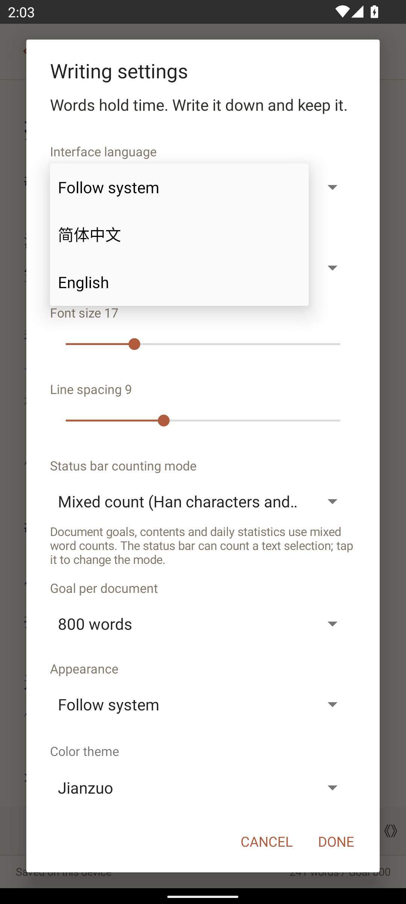

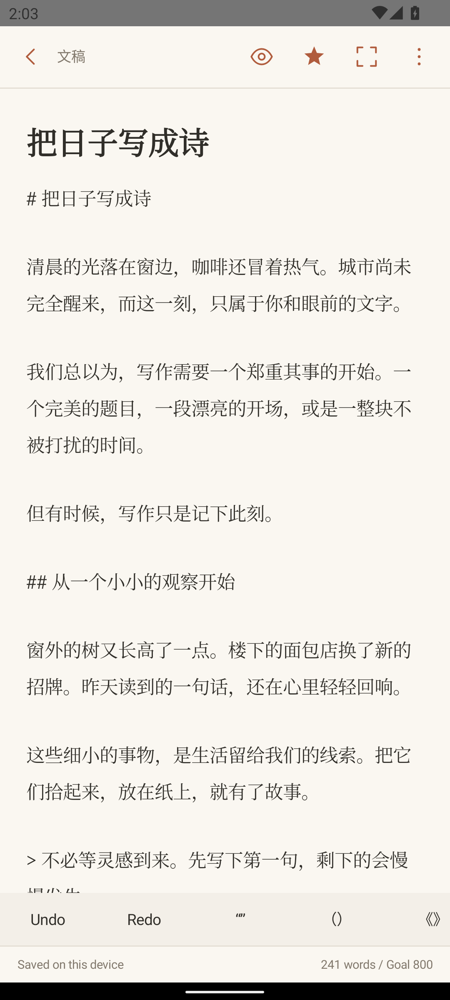

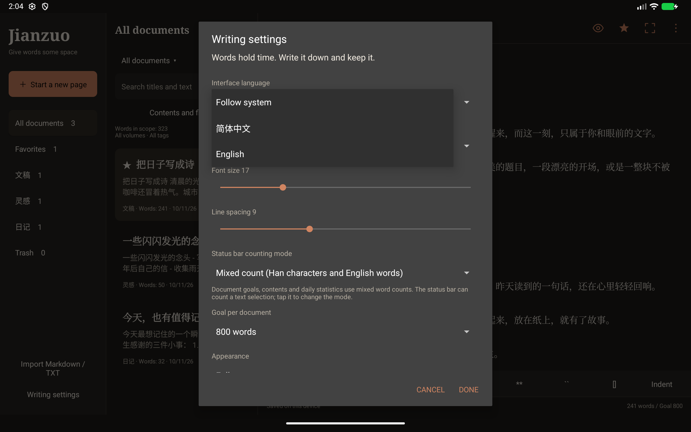

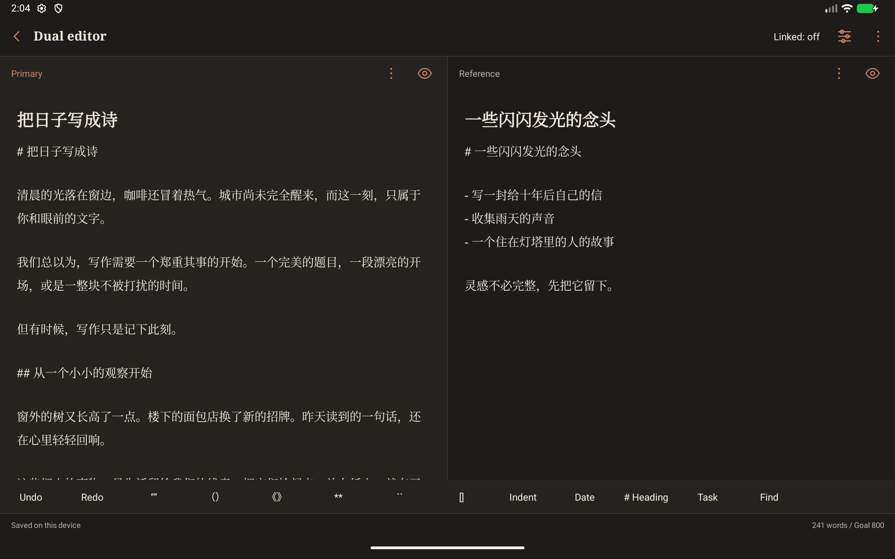

## 1.12.0 DeepSeek AI 续写

日期：2026-10-11（Asia/Shanghai），`versionName=1.12.0`、`versionCode=13`。文稿库格式保持 4，最低 Android 8.0。

- 新增个人 API Key／模型配置、连接测试、固定 DeepSeek HTTPS 请求、续写要求与三档长度，以及可修改的结果预览、复制、取消、重新生成和主动插入。中英文资源目前配对 **675 个字符串、6 组数组**，资源对应及格式参数检查通过。
- 续写按标题、有界前文及后文构造提示词，保留语言、叙述风格及已有后文，关闭思考模式；限制输入／输出长度，不自动重试、不跟随重定向。返回截断内容时明确提示，过滤／中断／空内容不作为可用结果。预览补齐明确句末的段落衔接，用户编辑后的结果按原样插入。
- 原文 ID、标题、正文、只读和删除状态共同校验；已应用的快照不能重复插入。当前可编辑页面对 Editable 作一次插入以保留系统撤销，保留原文历史。生成不计入人工写作时长或每日打字统计。保存与 AI 网络请求使用独立线程，取消／销毁／应用锁关闭窗口后不展示迟到结果。
- Key 使用 Android Keystore AES-GCM 加密，单独保存于私有配置，设置页掩码且禁止截图；留空保留已有 Key，可单独移除，不进入文稿库、.jzb、自动快照及系统备份。源码、文档、日志和最终 APK 的临时测试 Key 检查为 **0 命中**。

真实接口验证使用用户提供的临时 Key，先读取 `/models`，成功返回 `deepseek-flash` 与 `deepseek-v4-pro`，再使用生产 `DeepSeekClient` 请求 `/chat/completions`。协议依据 [DeepSeek 官方接口文档](https://api-docs.deepseek.com/api/create-chat-completion/)。仅使用自建故事测试片段，不包含用户文稿；总计 **4 次文字生成**，未自动重试，费用由该测试账号承担。

| 实际请求 | 输入 tokens | 输出 tokens | 结果 |
| --- | --- | --- | --- |
| JVM 中文文末续写 | 229 | 151 | 自然结束；原文历史、后文保留断言通过 |
| JVM 英文中间续写 | 222 | 91 | 自然结束；原文历史、后文保留断言通过 |
| API 37 Android 中文续写 | 229 | 118 | 自然结束；换行衔接、历史、后文保留断言通过 |
| API 37 Android 英文中间续写 | 219 | 126 | 自然结束；换行衔接、历史、后文保留断言通过 |

Android 的真实网络测试需明确启用 `LiveAiInstrumentedTest`；Key 通过标准输入送入应用私有缓存，不放在测试参数或源码中，读取后即删除，并在测试结束后核对不存在。常规全量回归排除该收费测试，单独实际运行 **1 项通过**（包含上述两次 Android 生成）。鉴权、余额、限流、异常响应、离线和超时分支使用可控响应验证。

完整回归在窗口清理修复前的 1.12 候选包执行（SHA-256 `6cfcd992c3fd7b53fbe877ad57ea6f309e540297aa5439fc2106c9e70efa6434`）；最后日志检查发现退出时 AI 窗口清理遗漏，修复后对最终包另行复验手机／平板的全部 AI 流程，新增重建取消检查，且日志中不再有 AI 窗口泄漏。已有功能代码未在清理修复中改动。

验证结果：

| 检查 | 结果 |
| --- | --- |
| JVM 单元检查 | **96 项通过**，无失败、错误或跳过；其中新增 15 项请求、错误、上下文、衔接、Unicode、安全插入与取消检查 |
| API 37 手机浅色竖屏 | **72 项通过**，无失败或跳过；1080 × 2400 / 420 dpi；全程 `w411dp h914dp`、`ROTATION_0` |
| API 37 平板横屏、系统深色 | **72 项通过**，无失败或跳过；2560 × 1600 / 320 dpi；全程 `w1280dp h800dp`、`ROTATION_90` |
| 构建及 Lint | 构建成功，**0 个错误、3 个既有警告**：低版本忽略 localeConfig 属性及工具／测试 JSON 依赖更新提示 |
| 最终包手机／平板 AI 检查 | **各 9 项通过**，无失败或跳过；包括页面重建取消，窗口日志无泄漏 |
| 安装包 | **1,453,497 字节**，1.12.0 / 13；APK Signature Scheme v2 验证通过，设备所装包与交付包哈希相同 |

新增 9 项普通设备检查覆盖：加密持久化与移除、连接测试／隐藏 Key、结果修改与确认插入／即时撤销、取消后丢弃迟到结果、原文变化保护、英文网络错误、真实菜单的缺失 Key 配置跳转，第二编辑器插入／主稿保留／光标定位，以及页面重建后的请求取消与迟到结果丢弃。既有导入、找回、备份、排版、目录、快捷栏、计时、主题和语言切换一并回归。

SHA-256：`551138829970724949eb1d72f6e56bef8e3423a6a50178710a88124fec68d1a8`。交付包为 `Build/Android/jianzuo-android-debug.apk`，与 `SHA256SUMS.txt`、设备 APK 校验一致。构建、JVM XML、Lint、真实调用记录、唯一测试事件和方向检查保存在本机 `Build/Android/validation-1.12/`。

本轮只包含安卓主动 AI 续写，未加入实时副驾驶、标题建议、校对、对话及 Apple AI。生成结果仍需用户检查；超时或取消后 DeepSeek 仍可能计费。AI 窗口旋转时关闭，不保留待确认结果；可在操作前复制结果。此次新增 AI 的设备测试覆盖 API 37，Android 8–12 未单独运行新增 AI 设备测试。

截图使用界面测试夹具，**不是实际 API 输出或用户文稿**，不含 Key：

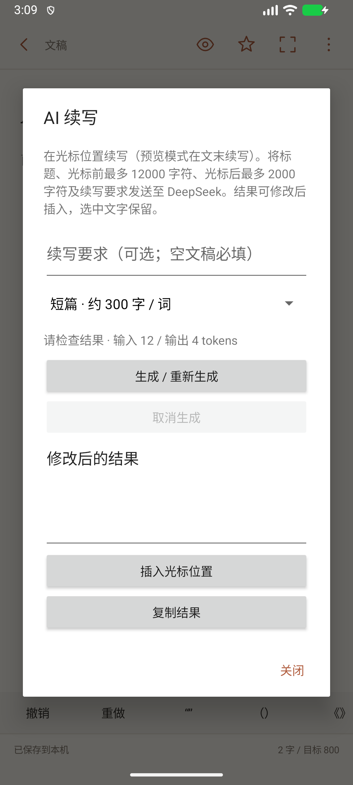

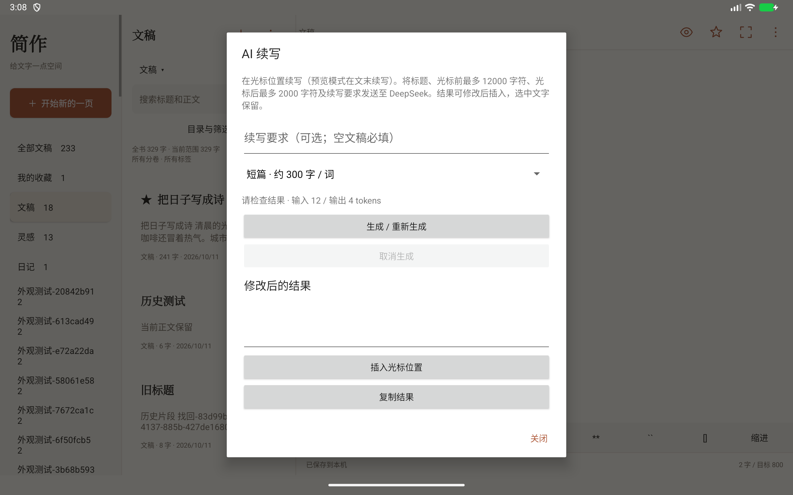
