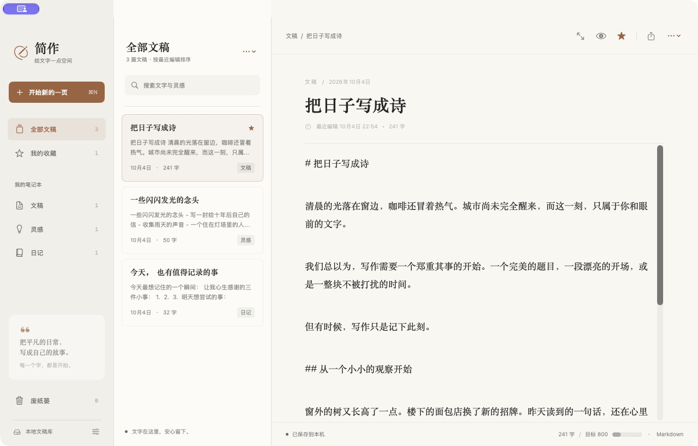
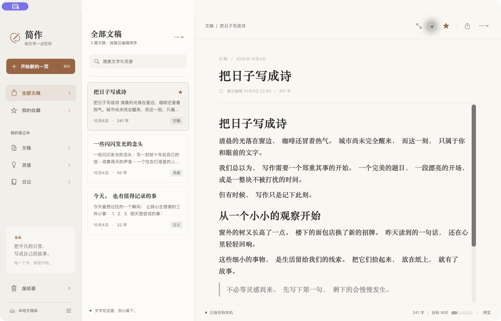
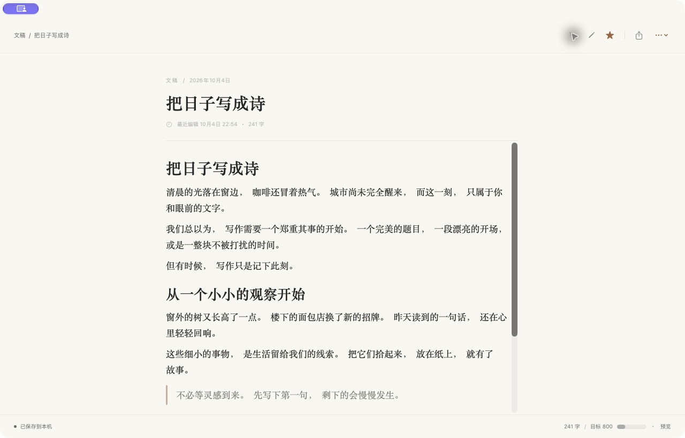
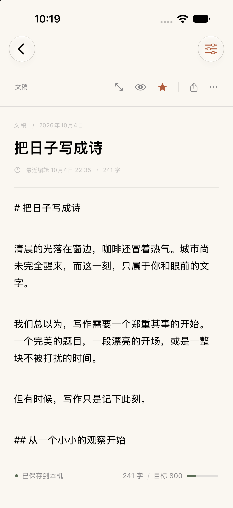
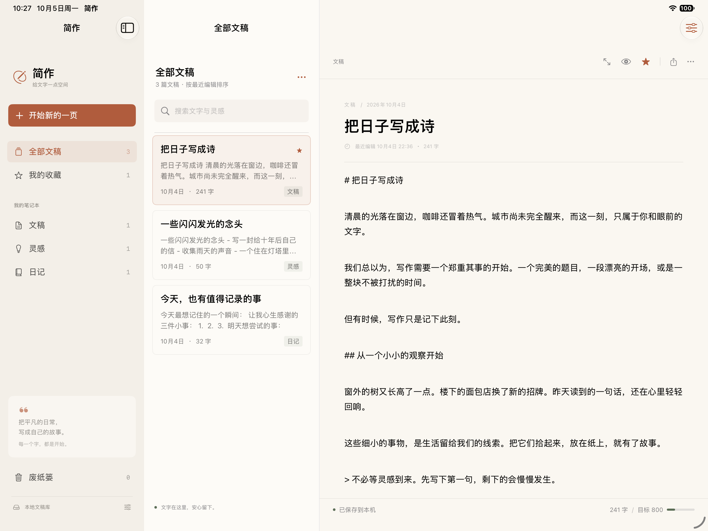
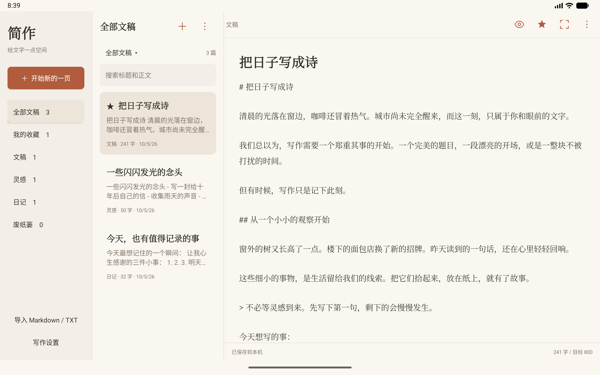

# 简作 · Jianzuo

**中文** · [English](README.en.md)

一个安静的原生写作空间。SwiftUI / Xcode 工程支持 **Mac、iPhone 和 iPad**；新增 Android Studio 原生工程支持 **安卓手机与平板**。两个平台的应用运行均无第三方依赖。

[下载发行版](https://github.com/mrlingan/jianzuo/releases) · [发行说明](Docs/Releases/v1.0.0.md) · [提交建议](https://github.com/mrlingan/jianzuo/issues) · [参与贡献](CONTRIBUTING.md)

## 界面截图

### Mac：笔记本、文稿列表与编辑器

左侧按笔记本或收藏浏览，中间搜索和切换文稿，右侧编辑正文。底部显示保存状态、字数和本文目标。



<details>
<summary>查看 Markdown 预览和专注模式</summary>

### Markdown 预览

点击工具栏眼睛图标，或按 `⇧⌘P`，将 Markdown 原文切换为标题、段落、列表和引用的排版预览。



### 专注模式

点击工具栏展开图标，或按 `⇧⌘F`，收起侧栏和文稿列表，将空间留给当前文稿。再次点击可退出；Mac 也可按 `Esc`。



</details>

### iPhone / iPad：随屏幕调整的写作空间

iPhone 使用文稿列表与编辑页的分层导航；iPad 在较宽的窗口中并排显示列表与正文，侧栏可按需展开。

<table>
  <tr><th>iPhone · 正文编辑</th><th>iPad · 并排浏览与编辑</th></tr>
  <tr>
    <td align="center"></td>
    <td align="center"></td>
  </tr>
</table>

截图来自 v1.0.0 的实际界面，使用项目自带的示例文稿；移动端截图来自 iPhone / iPad 模拟器。**App 界面目前为中文，README 提供中英文版本。**

## 功能与使用方法

| 功能 | 如何使用 |
| --- | --- |
| 原生写作 | 新建文稿后分别填写标题和正文。Mac 使用 NSTextView，iOS 使用 UITextView，支持中文输入、文本选择和原生撤销。 |
| 笔记本与搜索 | 内置「文稿」「灵感」「日记」，可创建和重命名自定义笔记本；搜索匹配标题、正文和标签，列表按最近编辑时间排序。 |
| Markdown 预览 | 眼睛图标切换编辑 / 预览，支持标题、粗体、斜体、链接、引用、有序 / 无序列表、代码块和分隔线。 |
| 收藏与整理 | 星标收藏文稿；「更多」菜单支持创建副本、移动笔记本和移到废纸篓。Mac 列表也支持右键操作。 |
| 废纸篓 | 删除的文稿先保留在废纸篓，可恢复；彻底删除需要确认，执行后不可撤销。 |
| 导入与导出 | 列表「更多」菜单导入 UTF-8 Markdown / TXT，先预览、勾选、改名和排序；编辑器分享图标导出正文。Mac 可选 Markdown 或 TXT，iOS 导出 Markdown。 |
| 本地自动保存 | 停止编辑约 450 毫秒后保存，离开前台时立即保存。采用原子写入；读取失败时保留原文件并提示错误。 |
| 字数与目标 | 中文逐字、英文按单词统计；「更多 → 文稿统计」查看字符数和预计阅读时间。设置中可选每篇文稿目标或关闭目标。 |
| 写作设置 | 调整宋体 / 系统 / 等宽字体、14–26 号字号、行距，以及跟随系统 / 浅色 / 深色外观。 |
| 专注写作 | 收起导航栏位，保留当前文稿与保存状态；可与 Markdown 预览一起使用。 |

### Apple 1.1.0：继续补齐本地写作能力

Mac、iPhone 与 iPad 新增自定义笔记本、标签筛选、只读文稿、最近 40 份历史恢复、SHA-256 校验完整备份和最近 10 份本机自动备份；同时加入勾选查找替换、大纲定位、排版预览、双稿编辑、速记、每日字数、可配置快捷输入栏，以及五套配色和横线稿纸。

侧栏进入「备份与恢复」「每日写作」「速记」，编辑器「更多」打开写作工具；设置中可预览配色并配置 1–3 行快捷输入。宽窗口并排双稿，手机或小窗口使用切换栏。完整说明、验证范围和与安卓仍有的差距见 [Apple 功能对照](Docs/Apple-feature-parity.md)。

Apple v1 文稿库首次保存升级为 v2，旧版 Apple 1.0 无法读取升级后的库。Apple 完整备份可在 Apple 设备间交换，暂不兼容安卓备份；跨平台仍使用 Markdown / TXT。

### 快速开始

1. 点击「开始新的一页」，输入标题和正文，内容会自动保存。
2. 用笔记本整理文稿，或点击星标收藏常用内容。
3. 点击眼睛图标检查排版；点击展开图标进入专注模式。
4. 写完后通过导出按钮保存一份 Markdown 文件，也可将它导入其他设备。

### Mac 快捷键

| 快捷键 | 操作 |
| --- | --- |
| `⌘N` | 新建文稿 |
| `⌘O` | 导入文稿 |
| `⌘S` | 立即保存 |
| `⇧⌘E` | 导出当前文稿 |
| `⇧⌘P` | 切换 Markdown 编辑 / 预览 |
| `⇧⌘F` | 切换专注模式 |
| `Esc` | 退出专注模式 |

## 下载与安装

前往 [GitHub Releases](https://github.com/mrlingan/jianzuo/releases) 获取安装包及校验文件。

| 下载类型 | 适用场景与要求 |
| --- | --- |
| Mac DMG / ZIP | macOS 14 起，包含 Apple Silicon（arm64）与 Intel（x86_64）。将「简作.app」移到 Applications。 |
| iOS 未签名 IPA | iOS / iPadOS 17 起，arm64 真机包，源码直接构建、未加密、未签名。**需使用自己的有效证书和描述文件重新签名后安装**。 |
| iOS Simulator ZIP | 仅适用于 Xcode 中的模拟器，不能安装到真机；当前发行包使用 iOS 27 SDK 构建。 |

Mac 发行包使用 ad-hoc 签名，尚未经过 Developer ID 签名或 Apple 公证。首次打开可能出现 macOS 安全提示，请核实下载来源并按系统提示操作。未签名 IPA 尚未在真实 iPhone / iPad 上安装验证。

在解压模拟器包的目录中，启动一个模拟器后运行：

```sh
xcrun simctl install booted Jianzuo.app
xcrun simctl launch booted com.jianzuo.writing
```

## 数据与当前范围

- Apple 版本文稿保存在当前设备的 `Application Support/Jianzuo/library.json`；Mac 沙盒版位于应用自己的沙盒容器内。安卓版本使用应用私有目录的 `files/library.json`。
- 各设备独立保存文稿，**当前没有 iCloud 同步**。通过导入 / 导出交换文件；重要文稿请定期导出备份。
- 导出的是正文，标题用于文件名；笔记本、收藏和创建时间等库内信息不写入导出的 Markdown / TXT。
- Markdown 预览暂不渲染图片、表格或 HTML，这些内容仍按原文保留和导出。
- 字数目标按当前文稿计算，不是每日累计目标。
- 项目文档提供中英文；安卓 1.11.0 提供简体中文／English 界面及跟随系统选项，Apple 版本界面目前为中文。

## 安卓手机 / 平板版本

用 Android Studio 打开 [`Android`](Android) 目录，选择 `app` 和手机 / 平板模拟器或真机运行。最低 Android 8.0，一个 APK 自动适配手机的分层导航、平板的双栏 / 三栏布局以及分屏窗口。

安卓版本包含笔记本、搜索、收藏、原生编辑、Markdown 预览、专注模式、自动保存、废纸篓、Markdown / TXT 导入导出、字数目标、字体和深浅色设置。各平台独立存储文稿，通过导入 / 导出交换正文。

安卓 1.1.0 增加历史恢复、校验备份、自定义笔记本、章节与标签、查找替换、排版、大纲、第二编辑器、速记、每日统计、快捷输入，以及 PDF／PNG／HTML／ZIP 导出。详细入口及与竞品的差异见 [APK 功能检查与实现对照](Docs/PureWriter-analysis.md)。云同步尚未接入；1.12.0 已接入 DeepSeek AI 续写。

安卓 **1.2.0** 继续加入历史差异、勾选替换、多文件导入预览／改名／排序、段落移动、每日目标与年度回顾、笔记本桌面快捷方式，以及 DOCX／EPUB 导出和富文本复制。HTML 支持基础 Markdown 排版。

安卓 **1.3.0** 加入独立分卷与空卷、折叠目录、精确标签筛选、章节拖动和批量编号预览；支持整卷移动／回收／恢复，成书导出按卷及章节顺序排列，旧文稿库自动迁移。

安卓 **1.4.0** 加入常驻双稿编辑、独立预览／选稿、比例调整与联动滚动，两篇分别保存位置和历史；同时补齐章节前后新建及拖动目录自动滚屏。

安卓 **1.5.0** 加入 1–3 行可配置快捷输入栏，支持隐藏、拖动排序和直接编辑多行内容；状态栏可切换四种计数口径，并显示当前正文选区计数。

安卓 **1.6.0** 加入自动写作时长、停笔／后台暂停、每日及年度／月度汇总；备份可选择恢复统计，同日取较大值防止重复累加。新库格式 4 兼容读取旧库，升级后需 1.6.0 或更新版读取。

安卓 **1.7.0** 补齐文件夹扫描、系统分享／打开文本导入、旋转保留导入预览，以及大文稿导出临时快照；修复小屏勾选项裁切和导入后旧筛选隐藏新文稿。详见 [未完成功能检查记录](Docs/Android-unfinished-audit.md)。

安卓 **1.8.0** 新增扫描进度、取消和数字自然排序；「备份与恢复」可按关键词搜索当前文稿、废纸篓、历史及本机自动备份，预览后保存为新文稿。详见 [Android 使用说明](Android/README.md)。

安卓 **1.9.0** 补齐 PDF／长图的 Markdown 排版，可选择保留标记的原文模式；支持跨页表格表头、代码与引用样式，先完成排版再写入目标，超限时保留已有文件。

安卓 **1.11.0** 支持简体中文／English 界面和跟随系统选项；提供五套内置配色、横线稿纸及保存前实时预览。切换语言保留文稿和用户命名，单稿、双稿与原文只读共用样式。

```sh
# 构建调试 APK，同时运行单元测试与 Lint
bash Scripts/build_android.sh
```

输出：`Build/Android/jianzuo-android-debug.apk`。详见 [Android 工程说明](Android/README.md) 和 [验证记录](Docs/Android-validation.md)。



## 在 Xcode 运行

最低系统版本为 macOS 14、iOS / iPadOS 17，无需安装第三方库。

1. 克隆仓库，打开 `Jianzuo.xcodeproj`。
2. 选择 `Jianzuo` Scheme 和 `My Mac`、iPhone 或 iPad 模拟器，按 `⌘R`。
3. 如需运行到真机，在 Signing & Capabilities 中选择自己的开发团队，连接设备后运行。

```sh
git clone https://github.com/mrlingan/jianzuo.git
cd jianzuo
open Jianzuo.xcodeproj
```

### 构建与测试

```sh
# Mac 单元测试
xcodebuild -project Jianzuo.xcodeproj -scheme Jianzuo \
  -destination 'platform=macOS' -derivedDataPath Build/Mac \
  CODE_SIGNING_ALLOWED=NO test

# iOS 模拟器构建
xcodebuild -project Jianzuo.xcodeproj -scheme Jianzuo \
  -sdk iphonesimulator -destination 'generic/platform=iOS Simulator' \
  -derivedDataPath Build/iOS CODE_SIGNING_ALLOWED=NO build
```

现有 15 项单元测试覆盖字数、存储与损坏文件保护、旧库迁移、校验备份、历史恢复、笔记本与标签、Unicode 勾选替换、大纲和导入预览。本轮 Mac 全部通过，iOS 模拟器构建通过；因本机无可用运行时，移动端运行验证尚未完成，详见 [Apple 验证记录](Docs/Apple-feature-parity.md)。

### 发行打包

```sh
# Mac DMG / ZIP、模拟器 ZIP、未签名真机 IPA 和校验文件
bash Scripts/package_release.sh 1.0.0

# 仅打包未签名真机 IPA
bash Scripts/package_ipa.sh 1.0.0
```

输出目录为 `Build/Releases/v1.0.0`。`SHA256SUMS.txt` 校验 Mac 和模拟器包，IPA 使用独立的 `.ipa.sha256` 文件。

### 项目结构

| 目录 / 文件 | 内容 |
| --- | --- |
| `Android` | Android Studio 工程，原生 Java 界面、自适应手机 / 平板布局与测试 |
| `Jianzuo/Models` | 文稿模型、统计、本地存储与文稿操作 |
| `Jianzuo/Views` | 跨平台界面、原生编辑器、Markdown 预览与设置 |
| `JianzuoTests` | 存储与文稿行为测试 |
| `Scripts` | 工程生成、图标绘制和发行打包脚本 |
| `Docs/Screenshots` | README 使用的真实界面截图 |
| `Docs/Releases` | 发行说明 |

`Scripts/create_project.py` 可重新生成 Xcode 工程与颜色资源；图标的可编辑 Sketch 源文件位于 `Design/AppIcon/Jianzuo-Icon-Design.sketch`，`Scripts/make_icon.swift` 从设计导出图生成应用图标资源。

## 参与和许可

欢迎通过 [Issues](https://github.com/mrlingan/jianzuo/issues) 报告问题和提出建议，通过 Pull Request 提交改进。开发约定见 [CONTRIBUTING.md](CONTRIBUTING.md)。

本项目采用 [MIT License](LICENSE)。


### 安卓 1.11.0 中英文界面

「写作设置 → 界面语言」可选择跟随系统、简体中文或 English，点「完成」保存，取消保持原语言。Android 13 及以上与系统的应用语言设置共用选择；Android 8–12 使用本机设置。跟随中文系统使用简体中文，其他系统语言使用英文。

菜单、设置、统计、双编辑器、导入预览、找回和内置快捷项已提取为中英文资源。语言切换保留文稿、笔记本名称、历史和自定义快捷项原文；示例正文不会自动翻译。其他语言及 Apple 界面翻译仍待完成。验证和边界见 [Android 验证记录](Docs/Android-validation.md)。


### 安卓 1.12.0 DeepSeek AI 续写

「写作设置 → DeepSeek AI 设置」填写自己的 API Key，测试连接后保存；「文稿菜单 → 写作工具 → AI 续写」生成可编辑预览，再插入光标位置。支持续写要求、三档长度、重新生成、取消、复制及原文历史；已有正文变化时禁止覆盖。中英文界面均已覆盖。

Key 只在本机加密保存，不进入文稿备份或安装包。请求直接发送到 DeepSeek，费用由用户账号承担。已用用户提供的临时 Key 验证中文、英文及安卓设备的实际续写请求。配置、上下文范围和限制见 [Android 使用说明](Android/README.md)，测试结果见 [验证记录](Docs/Android-validation.md)。
